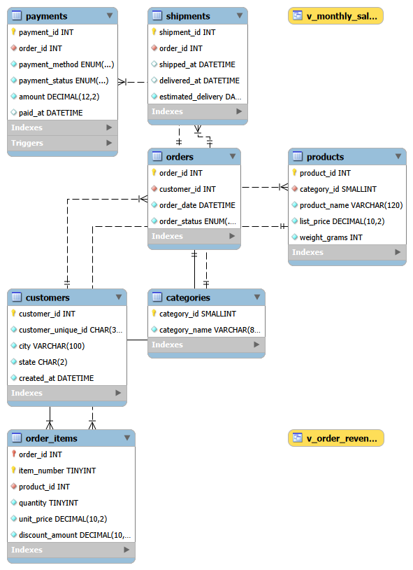

# Olist Marketplace Sales Analytics (MySQL 8.0)

An end-to-end SQL portfolio project that models a Brazilian online marketplace and turns order, payment, product, customer, and delivery data into business metrics. The schema and SQL are designed for MySQL Workbench 8.0 CE.

> **Dataset note:** rows in `data/02_seed_data.sql` are deterministic synthetic data created for this project. The business context is inspired by the [Olist Brazilian E-Commerce Public Dataset](https://www.kaggle.com/datasets/olistbr/brazilian-ecommerce); these rows are not copied from that dataset. The seed generates more than 7,000 rows across the seven tables.

## Business problem

Marketplace leaders need a trustworthy way to answer: How are sales changing over time? Which customer states, product categories, and products drive delivered revenue? Are payments consistent with order lines? How long does delivery take, and how often does it miss its estimate?

This project creates a normalized transactional model and an analysis layer to answer those questions in repeatable SQL.

## Database design

The model has seven tables in 3NF. Each table describes one entity or relationship; non-key facts depend on that table's key, the whole key, and nothing but the key.

| Table | Grain / key | Purpose |
|---|---|---|
| `customers` | One row per customer (`customer_id`) | Customer identity and home state |
| `categories` | One row per product category (`category_id`) | Category lookup |
| `products` | One row per product (`product_id`) | Price, weight, and category FK |
| `orders` | One row per order (`order_id`) | Customer FK, date, and status |
| `order_items` | One row per line (`order_id`, `item_number`) | Product FK, quantity, price snapshot, discount |
| `payments` | One row per order payment (`payment_id`) | Method, status, amount, order FK |
| `shipments` | One row per order shipment (`shipment_id`) | Dispatch, delivery, and estimated dates |

Primary keys uniquely identify rows. Foreign keys protect relationships (an order cannot reference a missing customer). `CHECK`, `UNIQUE`, `NOT NULL`, and `ENUM` constraints guard valid values. `order_items` stores the price at purchase time, so later list-price changes do not rewrite sales history.

### EER diagram



The PNG below was exported from MySQL Workbench 8.0 CE after arranging the project schema. Relationships are one-to-many from customers to orders, orders to order items, categories to products, and products to order items; payments and shipments are one-to-one with orders in this sample design. The two yellow objects are analytical views and therefore have no foreign-key connectors in the diagram.

## How to run in MySQL Workbench 8.0 CE

1. Open a local MySQL 8.0 connection in Workbench.
2. Open and execute `schema/01_schema.sql` (lightning-bolt button). It creates the dedicated `olist_resume_analytics` schema.
3. Open and execute `schema/02_analytics_objects.sql` to create two views, a stored procedure, and a payment-validation trigger.
4. Open and execute `data/02_seed_data.sql` once. It loads 1,000 customers, 12 categories, 60 products, 1,200 orders, 3,600 order lines, 1,200 payments, and 1,200 shipments. The final result grid shows table row counts.
5. Open and execute `schema/03_indexes_and_plans.sql`. Compare the two `EXPLAIN` result grids around the index creation.
6. Open `queries/04_business_questions.sql`. Run one numbered query at a time by selecting its statement and clicking the lightning bolt. The final statement calls the stored procedure.
7. To re-export the EER PNG: open the project model in Workbench, arrange the diagram, then use **File → Export → Export as PNG** and save as `screenshots/eer_diagram.png`.

The schema script uses `CREATE DATABASE IF NOT EXISTS` and never drops or modifies another schema. The seed script resets rows only inside `olist_resume_analytics` so it can be re-run deterministically. It toggles foreign-key checks only while clearing that project's tables.

## SQL concepts in this project

- **Primary and foreign keys:** `orders.order_id` uniquely identifies an order; `orders.customer_id` points to a valid customer.
- **Normalization:** customer city/state are stored once per customer instead of repeated in every order. Product category names live in `categories`, not on every product.
- **JOIN:** questions 6 and 7 combine products, categories, line items, and orders to attribute revenue to categories and products.
- **GROUP BY / HAVING:** questions 2 and 20 summarize status and filter customers with multiple orders.
- **Subqueries and CTEs:** questions 8, 9, and 22 calculate a comparison baseline in a named intermediate result.
- **Window functions:** question 13 uses `LAG` for month-over-month change; 14 uses `RANK`; 15 uses `ROW_NUMBER`; 16 builds a running total; 26 uses `NTILE`.
- **Views:** `v_order_revenue` centralizes line-total math; `v_monthly_sales` reuses it for monthly reporting.
- **Stored procedure:** `sp_sales_by_state(start_date, end_date)` accepts a date range and returns delivered sales by state.
- **Trigger:** `trg_payment_amount_matches_items` blocks a new payment when it differs from the order's item total by more than one cent.
- **Indexes / EXPLAIN:** `03_indexes_and_plans.sql` compares a date-range access plan before and after a composite index. The optimizer may still choose a table scan on a small table; explain the chosen plan rather than promising a speedup.

## Key findings

Findings are calculated from the included synthetic data and may change if the seed logic changes. The EER export is included. Add genuine Workbench result captures to `screenshots/` after running the scripts; the repository does not include fabricated screenshots.

- Orders span January 2024 through December 2025, enabling a monthly trend and `LAG` comparison.
- Status and payment distributions are intentionally varied, including canceled/refunded and processing/pending cases for lifecycle analysis.
- The synthetic shipment dates include late and not-yet-delivered orders so delivery performance can be measured.
- All payment amounts are generated from order lines; the trigger adds a guard against later mismatches.

## Repository layout

```text
README.md
schema/
  01_schema.sql
  02_analytics_objects.sql
  03_indexes_and_plans.sql
data/
  02_seed_data.sql
queries/
  04_business_questions.sql
screenshots/
  README.md
  eer_diagram.png  (export from Workbench)
```

## Resume bullets

- Designed a 7-table, 3NF MySQL marketplace schema with primary/foreign keys, validation constraints, and deterministic synthetic data exceeding 7,000 rows.
- Wrote 28 business queries using multi-table joins, aggregates, CTEs, subqueries, and window functions to analyze revenue, repeat purchases, product mix, and delivery performance.
- Built reusable views, a parameterized stored procedure, payment-integrity trigger, and query-plan comparison for an indexed date-range lookup.

## Interview practice

1. Why is `order_items` a separate table instead of putting product columns on `orders`?
2. What makes `(order_id, item_number)` a useful composite primary key?
3. How does `v_order_revenue` avoid repeating the line-total expression?
4. What would change if one order could have multiple payments?
5. Why does question 13 use `LAG`, and what is its first row's prior-month value?
6. Explain the difference between `RANK` and `ROW_NUMBER` in question 14/15.
7. Why does the shipment query use `DATEDIFF` and filter out missing delivery dates?
8. What problem does the payment trigger catch, and what limitation does a `BEFORE INSERT` trigger have?
9. Which columns are covered by `idx_orders_date_status`, and why does column order matter?
10. If monthly sales doubled, how would you investigate whether it was real growth or a data issue?

## Limitations and next steps

This is a learning portfolio model, not a production payment or fulfillment platform. It uses synthetic data, a one-payment/one-shipment-per-order assumption, and order-line sales as merchandise revenue (shipping/tax are not modeled). Useful extensions include loading the original public CSVs, adding seller/review entities, and testing on a larger dataset.
